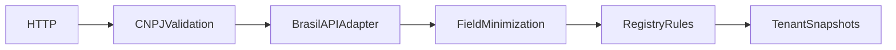

# Company Radar

O cadastro de fornecedores exige evidência verificável e revisão humana; um status opaco não explica o que precisa de atenção.

Plataforma executável com dashboard responsivo, API autenticada e integração real com **BrasilAPI**.


## Funcionalidades

Validação de dígitos verificadores de CNPJ; consulta cadastral real; revisão de situação e completude; minimização dos campos retornados; snapshots por workspace; exclusão de snapshots; proveniência da resposta.

## Executar

Python 3.12 ou 3.13. Na pasta do projeto:

```powershell
python -m venv .venv
.venv\Scripts\Activate.ps1
python -m pip install -r requirements.txt
python -m uvicorn app.main:app --host 127.0.0.1 --port 8202
```

Linux/macOS: `source .venv/bin/activate`.
Abra http://localhost:8202 e execute a análise.
O modo inicial da interface é **demonstração sintética**. Para consultar a fonte,
selecione **Consultar API pública**. Falhas do provedor são exibidas, sem substituição silenciosa por exemplos.
O contrato OpenAPI está em http://localhost:8202/docs.

Chaves locais: `local-alpha` e `local-beta`. A identidade do workspace é derivada da chave,
nunca de um header arbitrário de tenant. Configure `API_KEYS` antes de exposição externa.

## API

| Método | Rota | Função |
| --- | --- | --- |
| POST | `/api/analyze` | Consultar fonte, analisar e persistir snapshot |
| GET | `/api/history` | Últimos 30 snapshots do workspace |
| DELETE | `/api/history/{id}` | Excluir snapshot próprio |
| GET | `/health` | Liveness do processo |

Operações de negócio exigem `X-API-Key`. Exemplos completos estão na interface e no contrato `/docs`.

```bash
python -m pytest -q
docker build -t company-radar .
docker run --rm -p 8202:8202 company-radar
```

O banco no container é efêmero sem volume. Os testes usam banco temporário e transporte HTTP simulado,
sem depender da disponibilidade externa. O workflow testa Python 3.12 e 3.13.

## Arquitetura



O adaptador HTTP tem hosts permitidos, timeout explícito, cache TTL de cinco minutos,
capacidade limitada a 128 entradas e até duas tentativas para timeout/erro de rede ou erro 5xx inicial.
Não segue redirecionamentos nem repete 429. Não entrega cache expirado como se fosse atual.
O cache contém somente respostas públicas e é local ao processo; snapshots são isolados por workspace.

Leia [arquitetura](docs/architecture.md), [metodologia](docs/methodology.md),
[fontes](docs/data-sources.md), [operação](docs/runbook.md) e [segurança](SECURITY.md).

## Limites conhecidos

Apenas CNPJ numérico de 14 dígitos: formatos alfanuméricos não são suportados. Dados de origem podem estar defasados. Não compara snapshots automaticamente, não faz consulta de sanções e não implementa análise de crédito. Respostas do provedor podem conter dados adicionais; contatos e sócios não são expostos nem persistidos no snapshot.

## Evolução

Adicionar carteiras de fornecedores, comparação campo a campo entre snapshots, política de retenção e autorização por função. Suporte a novos formatos exige especificação e testes próprios.

## Implementação em Java 21

Motor nativo integrado ao fluxo de análise, com testes próprios. Veja [execução e protocolo](docs/polyglot.md).

## Dashboard React + TypeScript

`web/` contém o frontend tipado, com estado de consulta, histórico e gráficos SVG. Execute `npm ci` e `npm run build` dentro de `web/`; a API servirá o build em `/`. Para desenvolvimento use `npm run dev` com a API ativa. Sem build, a API mantém uma console HTML funcional de apoio.

A imagem Docker compila o frontend e o motor nativo e j? ativa o componente Go/Java/Rust correspondente. O modo Python continua dispon?vel na execu??o local sem NATIVE_ENGINE.

## Verificação em navegador

O job `browser` da CI executa fluxos em Chromium, verifica a versão de 390 px e publica capturas como artifact `dashboard-screenshots`. Execute `npm install` em `ui/`, `npx playwright install chromium` e `node ui/smoke.cjs` na raiz com a API em localhost:8000 para repetir.
